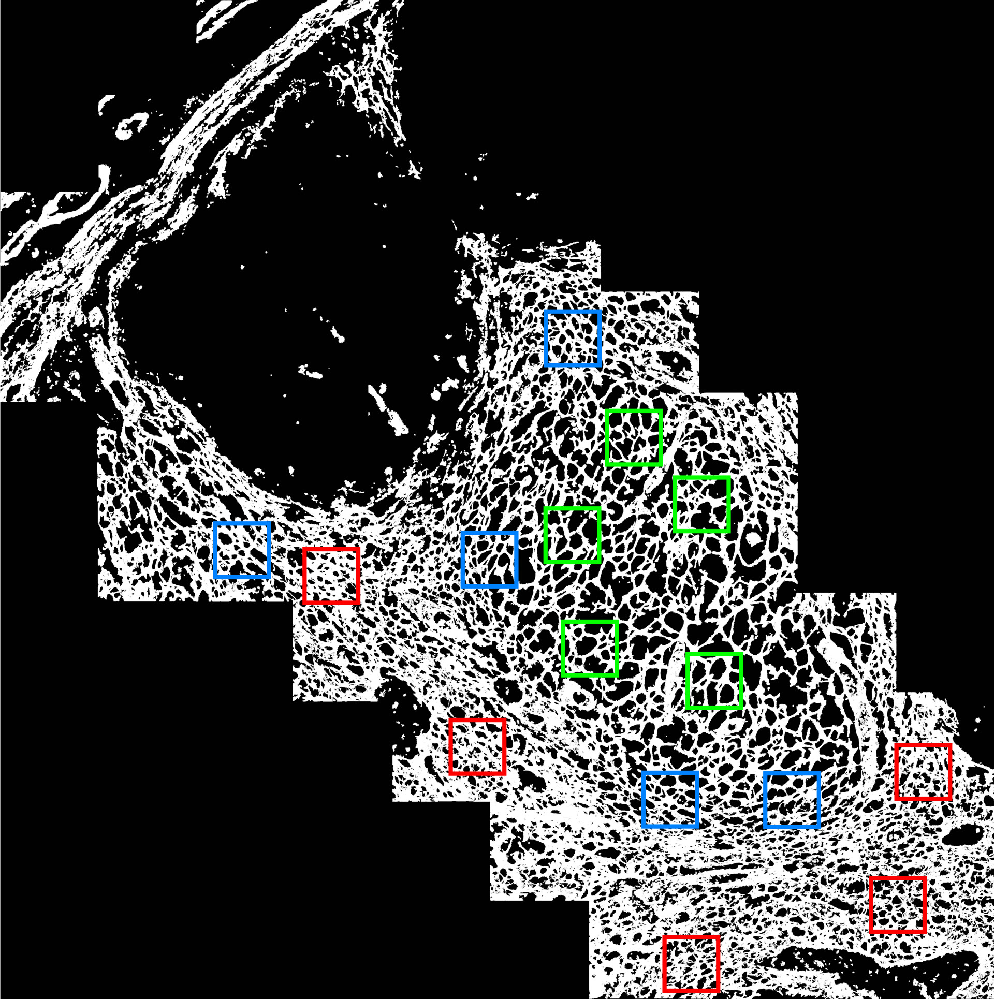
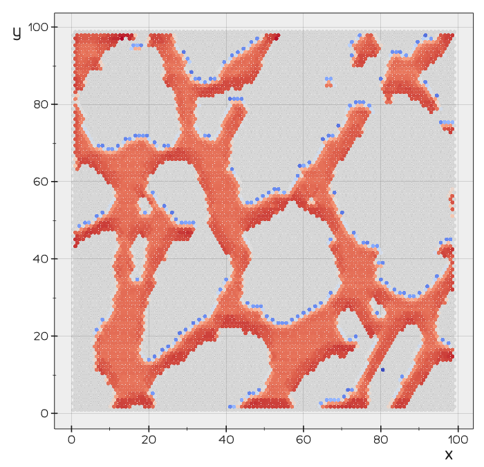

# Agent-Based Mechanobiology of Human Lymph Node Actin Networks

Pipeline for reconstructing three-dimensional actin structures from confocal laser scanning microscopy (3D TIFF stacks) of human lymph nodes, converting them into agent-based representations, and simulating mechanobiological properties such as elasticity.

This work was developed as a BSc Physics thesis at Goethe University Frankfurt in collaboration with the Matthäus Group at the Frankfurt Institute for Advanced Studies (FIAS), using microscopy data from the Martin-Leo Hansmann group (University Hospital Frankfurt) and FIAS.

> **Status:** Archived academic project — cleaned up for reference.

<p align="center">
  
    
  
  <br />
  <em><strong>Left:</strong> Confocal microscopy data of human lymph node actin structures. <strong>Right:</strong> Discretized agent-based representation undergoing mechanical probing.</em>
</p>

## Overview & Pipeline

1. **Image Preprocessing & Mesh/Agent Initialization (`code/`):** Converts 3D confocal microscopy TIFF stacks into `.vtk` structures to initialize the agent-based model.
2. **GPU Simulation & Mechanical Inference (`code/`):** Runs agent-based mechanics simulations in CUDA/C++ to probe tissue elasticity and deformation response.
3. **Statistical Analysis & Visualization (`code/`):** Analyzes simulation outputs and generates plots and animations.

For theoretical background, methodology, and main results, see `slides.pdf`.

## Prerequisites

- **Python** 3.8+ with `numpy`, `matplotlib`, `vedo`, and `tifffile`
- **NVIDIA CUDA Toolkit** (`nvcc`) and a CUDA-capable GPU (for compiling and running the simulation modules)
- **FFmpeg** (for rendering animations)

## Getting Started

1. Clone the repository:
   ```bash
   git clone https://github.com/Xilaeth/lymph-node-mechanobiology.git
   cd lymph-node-mechanobiology
